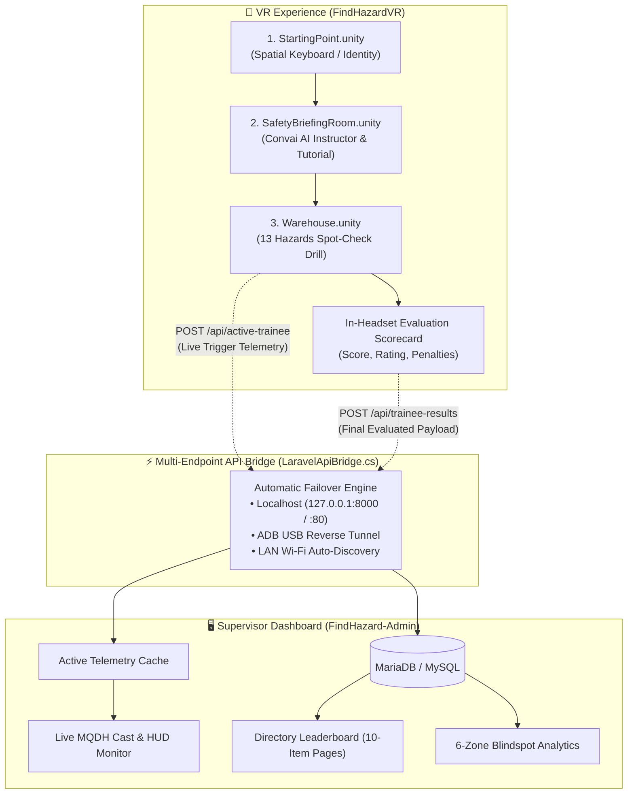

# 🥽 FindHazard VR — Aviation Cargo Hazard Inspection Drill

[-blue.svg?logo=unity)](https://unity.com/)
[](https://unity.com/srp/universal-render-pipeline)
[](https://docs.unity3d.com/Packages/com.unity.xr.interaction.toolkit@3.5/manual/index.html)
[](https://www.meta.com/quest/quest-3/)
[](https://git-lfs.github.com/)

> **An immersive virtual reality safety spot-check training simulation designed for aviation freight and warehouse logistics operations.**  
> Built for **Meta Quest 3** and **PC XR Interaction Simulator** using **Unity 6**. Features real-time bidirectional telemetry streaming to the **[FindHazard-Admin](https://github.com/faizzadham/FindHazard-Admin)** web command center.

---

## 🧭 System Architecture & Telemetry Pipeline



---

## 🌟 Key Features

* **3-Stage Progressive Training Flow**:
  * **Onboarding (`StartingPoint.unity`)**: Trainee identification using VR Spatial Keyboard input and local profile persistence.
  * **Interactive Briefing (`SafetyBriefingRoom.unity`)**: Hands-on tutorial with an interactive spatial slide navigator and Conversational AI safety instructor (powered by Convai).
  * **Spot-Check Drill (`Warehouse.unity`)**: Timed inspection drill featuring 13 industrial hazards and realistic safe-object distractors.
* **Objective Mathematics & Penalty Engine**:
  * Base Detection Score ($+7.69\%$ per authentic hazard identified).
  * Trigger Discipline Penalty ($-5.0\%$ deduction per safe object clicked).
  * Clamped scoring ($0.0\% - 100.0\%$) with automated tier assignment.
* **Seamless Multi-Endpoint Failover (`LaravelApiBridge.cs`)**:
  * Automatically switches between Apache (Port 80), Artisan (Port 8000), USB ADB Reverse Tunnel, and Wi-Fi LAN IPs without throwing fatal connection errors.
* **Integrated USB Reverse Tunneling (`AutoAdbReverseTunnel.cs`)**:
  * Editor utility automatically runs `adb reverse tcp:8000 tcp:8000` on Android build or script reload for instant USB-tethered telemetry.
* **In-Headset HUD & Results Scorecard (`EvaluationResultUI.cs`)**:
  * Real-time timer, hazard counter, animated circular score gauge, and post-drill breakdown showing score, missed hazards, wrong clicks, and tier grade.

---

## 🏢 The 6 Operational Zones & 13 Safety Hazards

The warehouse environment is divided into 6 functional operational zones containing exactly 13 safety hazards:

| Zone | Icon | Hazards Included | Severity Category |
|---|:---:|---|---|
| **Aircraft Parts Storage** | ✈️ | **1.** Fluid & Oil Leak Slip Hazard<br/>**2.** Dislodged Aircraft Parts | High Slip Risk<br/>Foreign Material |
| **Cargo Storage** | 📦 | **3.** Unstable Cargo Stack<br/>**4.** Blocked Emergency Exit | Stack Collapse<br/>Life Safety Egress |
| **Main Cargo Handling** | 🚜 | **5.** Overloaded Forklift<br/>**6.** Unsecured High-Shelf Boxes | Heavy Mobile Equipment<br/>Falling Object Hazard |
| **ULD Storage** | 📐 | **7.** Improperly Stacked ULD Containers<br/>**8.** Damaged ULD Wall Integrity | Structural Instability<br/>Airworthiness Failure |
| **Loading/Unloading Area**| ⚡ | **9.** Exposed 480V Power Cable<br/>**10.** Accumulated Packaging Debris<br/>**11.** Crushed Bottom Pallet Base | Electrical Arc Hazard<br/>Combustible Waste<br/>Catastrophic Collapse |
| **Airside Cargo Perimeter**| 🛫 | **12.** Tarmac Foreign Object Debris (FOD)<br/>**13.** Dislodged Restraint Net on PMC Pallet | Flight Safety Critical<br/>Cargo Restraint Failure |

---

## 📊 Evaluation & Performance Tiers

| Tier | Final Score | Color | Qualification Status | Description |
|---|:---:|:---:|:---:|---|
| **Locked In** | $\ge 90.0\%$ | 🟢 Emerald | **Certified ★** | Exemplary situational awareness; flawless or near-flawless inspection. |
| **Great** | $80.0\% - 89.9\%$ | 🔵 Sky Blue | **Certified ✓** | Satisfies regulatory safety benchmarks with disciplined trigger control. |
| **Valid Effort**| $60.0\% - 79.9\%$ | 🟡 Amber | **Retest Required** | Demonstrates hazard awareness; score reduced by missed risks or penalties. |
| **Needs Review**| $< 60.0\%$ | 🔴 Rose Red | **Retest Required** | Significant detection gaps or high false-alarm rates; mandatory zone re-drill. |

---

## 🎮 Controls & Interaction Mapping

| Action | Meta Quest Touch Controller | XR Interaction Simulator (PC) |
|---|---|---|
| **Locomotion / Movement** | Left Thumbstick (Continuous / Teleport) | `W`, `A`, `S`, `D` Keys |
| **Snap / Smooth Turn** | Right Thumbstick | Mouse Look + `Right Click` |
| **Hazard Identification** | Aim Laser Ray + **Right Index Trigger** | Left Mouse Click on Object |
| **Spatial UI / Keyboard** | Point + **Index Trigger** | Left Mouse Click |
| **Grab Briefing Station** | Hover + **Grip Button** | Middle Mouse Button / `G` Key |

---

## 🛠️ Prerequisites & Installation

### 1. Requirements
* **Unity Version**: **`Unity 6 (6000.3.19f1)`** *(Download via Unity Hub)*.
* **Build Support Modules**:
  * Android Build Support (OpenXR, Android SDK & NDK Tools).
  * Windows Build Support (for PC VR / XR Simulator).
* **Git LFS**: Installed on your operating system.

### 2. Cloning the Repository
> [!IMPORTANT]
> This project uses **Git LFS** for 3D `.unity` scene files. You must initialize Git LFS before cloning.

```bash
# 1. Initialize Git LFS
git lfs install

# 2. Clone the repository
git clone https://github.com/faizzadham/FindHazardVR.git
cd FindHazardVR

# 3. Verify LFS assets are pulled
git lfs pull
```

### 3. Opening in Unity
1. Open **Unity Hub** and click **Add** > **Add project from disk**.
2. Select the cloned `FindHazardVR` directory.
3. Ensure the editor version is set to **`6000.3.19f1`**.
4. Allow Unity to resolve URP package shaders on initial launch.

---

## 🚀 Running the Project

### Method A: PC XR Interaction Simulator (No Headset Required)
1. Open the project in Unity Editor.
2. Navigate to `Assets/Scenes` and open **`StartingPoint.unity`**.
3. Press the **Play ▶️** button at the top of the Unity Editor.
4. Use standard mouse and keyboard controls to type a username, proceed to the briefing, and inspect the warehouse.
5. Telemetry automatically dispatches locally to `http://127.0.0.1/laravel/FindHazardAdmin/public/api`.

### Method B: Meta Quest 3 via USB Cable (Recommended for Headset Testing)
1. Connect Meta Quest 3 to your PC via a USB-C link cable.
2. Enable **USB Debugging** on the headset.
3. In Unity Editor, click **`Tools` > `FindHazard` > `Setup ADB USB Reverse Tunnel (Port 8000)`**.
4. In the Project window, select `File > Build Settings`, switch platform to **Android**, and select your connected Quest 3 device.
5. Click **Build and Run**. Telemetry will route seamlessly through the USB cable.

### Method C: Meta Quest 3 Standalone over Wi-Fi
1. Ensure your PC running **[FindHazard-Admin](https://github.com/faizzadham/FindHazard-Admin)** and your Quest 3 are on the **same Wi-Fi network**.
2. Run `ipconfig` on your PC to find your local IPv4 address (e.g. `192.168.1.50`).
3. In `Warehouse.unity`, select the `[LaravelApiBridge]` GameObject in the Hierarchy.
4. Set **Primary LAN URL** to:
   ```
   http://<YOUR_PC_IP>/laravel/FindHazardAdmin/public/api
   ```
5. Build and install the APK onto the Quest 3.

---

## 📁 Repository Directory Structure

```text
FindHazardVR/
├── Assets/
│   ├── Scenes/
│   │   ├── StartingPoint.unity          # Onboarding, Spatial Keyboard & Login
│   │   ├── SafetyBriefingRoom.unity     # Convai AI Instructor & Slide Briefing
│   │   └── Warehouse.unity              # 13 Hazards Inspection Simulation
│   ├── Scripts/
│   │   ├── Data/
│   │   │   └── TraineePerformanceData.cs
│   │   ├── Editor/
│   │   │   ├── AutoAdbReverseTunnel.cs   # ADB Reverse Tunnel (Port 8000)
│   │   │   └── GenerateBakedCellingLights.cs
│   │   └── Interactions/
│   │       ├── TrainingGameManager.cs   # Core drill logic, timer & scoring
│   │       ├── HazardFeedback.cs        # Hazard vs Safe Object click feedback
│   │       ├── LaravelApiBridge.cs      # Multi-endpoint HTTP telemetry bridge
│   │       ├── EvaluationResultUI.cs    # In-VR results scorecard UI
│   │       ├── SpatialBriefingStation.cs# Moveable briefing station
│   │       ├── ConvaiChatHUDToggle.cs   # AI Instructor interaction toggle
│   │       └── UniversalSlideNavigator.cs# Slide navigation controller
│   └── Settings/                        # URP & OpenXR Configuration
├── Packages/
│   └── manifest.json                    # XR Interaction Toolkit 3.5.1 & Dependencies
└── ProjectSettings/
    └── ProjectVersion.txt               # Unity 6000.3.19f1
```

---

## 🔗 Related Repositories

* **[FindHazard-Admin](https://github.com/faizzadham/FindHazard-Admin)**: Web supervisor command center, live WebRTC/MQDH cast monitor, directory leaderboard, PDF certificate generator, and 6-zone blindspot analytics.

---

## 📄 License & Attribution

This project is developed for aviation warehouse safety research and training.  
Developed by **Faiz Adham** &bull; **FindHazard VR Team**.
